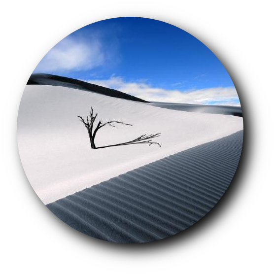

# user7210unix

 

 

## My Projects

<table>
<tr>
<td width="33%" valign="top">

### [4GAL](https://github.com/user7210unix/4gal)
A minimal gallery viewer for 4chan.

</td>
<td width="33%" valign="top">

### [Linux Dotfiles](https://github.com/user7210unix/dotfiles)
My Dotfiles.

</td>
<td width="33%" valign="top">

### [Wallpapers](https://user7210unix.github.io/papes/)
Curated collection.

</td>
</tr>
</table>

 

## Repos Worth Looking At

> Not mine, but in my setup or shaped how I configure things.

| Repo | Why |
|---|---|
| [**DankMaterialShell**](https://github.com/AvengeMedia/DankMaterialShell) | Desktop shell for Wayland compositors, built with Quickshell and Go |
| [**dots-hyprland**](https://github.com/end-4/dots-hyprland) | end-4's Hyprland config, one of the best out there |
| [**Tail-R/dots**](https://github.com/Tail-R/dots) | Clean Openbox configuration |
| [**my-theme-collection**](https://github.com/reorr/my-theme-collection) | GTK and icon theme collection |
| [**wzhchin/config**](https://github.com/wzhchin/config) | wzhchin's configuration files |
| [**nekonako/dotfiles**](https://github.com/nekonako/dotfiles) | nekonako's dotfiles |
| [**quartz-rice**](https://gitlab.com/Oglo12/quartz-rice) | Oglo12's dotfiles |
| [**TWM configs**](https://www.cpcnw.co.uk/twm2/themes/rackservers/) | rackservers configuration |
| [**IoskeleyMono**](https://github.com/ahatem/IoskeleyMono) | A font worth having |
| [**base16-emacs**](https://github.com/tinted-theming/base16-emacs) | base16 themes for Emacs |
